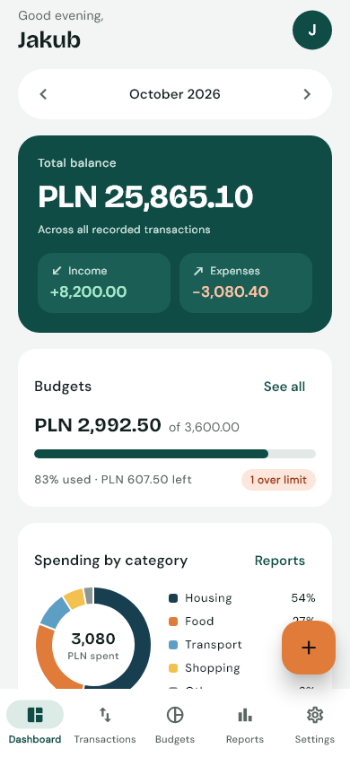
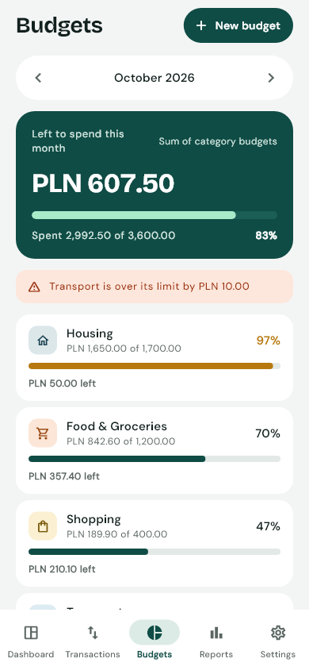
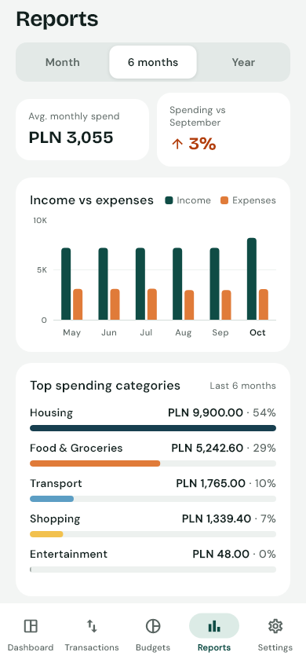
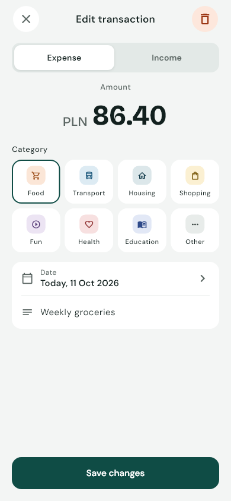
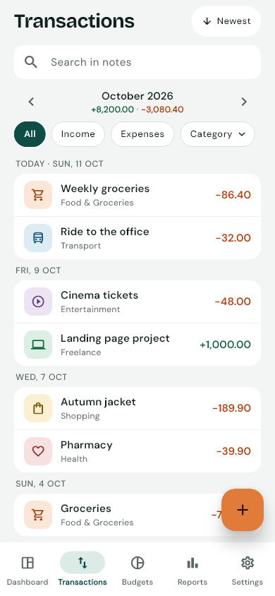
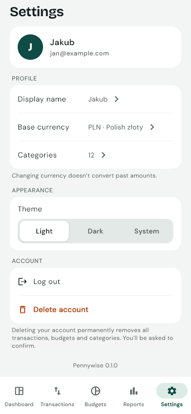
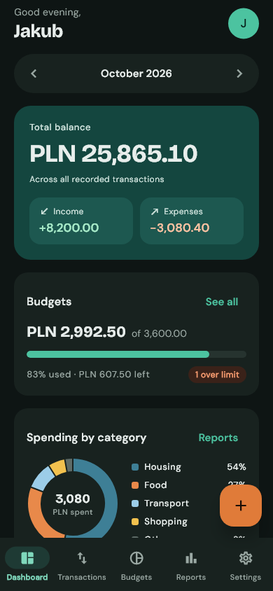

# Pennywise — Personal Finance

[](https://github.com/Romavel/Pennywise/actions/workflows/ci.yml)
[](https://github.com/Romavel/Pennywise/actions/workflows/integration.yml)

A Flutter app for tracking income, expenses and monthly budgets, backed by Firebase. Built as a portfolio project: the goal is a small, complete product with clean architecture, real security rules and tests at every level, rather than a long feature list.

<p>
  
  
  
  
</p>
<p>
  
  
  
  
</p>

## The problem

People who manage their own money often can't say what they spend the most on, how much is left until the end of the month, or whether they're staying within their limits. Pennywise answers that with quick manual entry (no bank connections), category budgets and clear statistics.

## Features

- **Accounts** — email/password sign-up and log-in, password reset, persistent sessions, protected routes, and account deletion that removes all data on the server.
- **Transactions** — add, edit and delete income and expenses; month view grouped by day with filters by type and category, note search and sort order.
- **Dashboard** — all-time balance, the month's income and expenses, budget progress, spending by category (donut chart) and recent transactions.
- **Budgets** — a monthly limit per category and an optional overall limit, progress bars with "near" and "over" states, six-month history per budget, copy last month's budgets in one tap.
- **Reports** — month / 6 months / year: average spending, change vs the previous month, income vs expenses chart, top categories and budget history.
- **Categories** — built-in categories with stable ids (rename, not delete) and custom ones with their own icon and colour.
- **Settings** — display name, base currency and light/dark/system theme, synced across devices through Firestore.
- **Offline-friendly** — writes are stored on the device and the UI says when something will sync later.
- Every data screen distinguishes **loading, empty, error and success** states; forms validate input and block double submissions.

## Stack

Flutter · Riverpod · go_router · Firebase Authentication · Cloud Firestore · Cloud Functions (TypeScript) · App Check · Crashlytics · fl_chart · intl · mocktail · fake_cloud_firestore · GitHub Actions

## Architecture

Feature-first, with three layers per feature:

```
lib/
  app/            MaterialApp, router (auth guard, bottom-nav shell), theme, bootstrap
  core/           shared utils (money, months, dates), errors, widgets
  features/
    auth/  transactions/  dashboard/  budgets/  reports/  categories/  settings/
      domain/        entities, repository interfaces, pure business rules
      data/          Firestore / Firebase implementations and providers
      presentation/  screens, widgets and Riverpod controllers
functions/        deleteAccount Cloud Function
firestore.rules   security rules
```

- **Screens never call Firebase.** They watch Riverpod providers, which expose repository interfaces from `domain/`. Tests swap the Firebase implementations for in-memory fakes with one override each.
- **Business rules are pure Dart.** Budget usage, balances, spending breakdowns, report statistics, filters and amount parsing live in `domain/` and are unit-tested without Flutter widgets or Firebase.
- **Money is integers.** Amounts are stored as `amountMinor` (4599 = 45.99 PLN) to avoid floating-point errors, and formatted only at the edge.
- **Errors are mapped once.** Data sources turn Firebase exceptions into `AppFailure`s with user-facing messages, so presentation code never depends on Firebase error codes.

## Security

- All of a user's data lives under `users/{uid}`; **Firestore Security Rules** allow access only to the signed-in owner and validate every write: field names and types, value ranges, server timestamps and immutable fields (e.g. a transaction's currency, a budget's month and category). 48 rules tests run on the emulator.
- **Account deletion** runs in a trusted environment: the app re-authenticates with the password and calls the `deleteAccount` Cloud Function, which also rejects sign-ins older than five minutes, deletes `users/{uid}` recursively and only then the Auth account, so no data is left without an owner. The app itself cannot delete the profile.
- **App Check** is activated (Play Integrity / App Attest, debug provider in debug builds); enforcement is switched on per service in the Firebase console.
- **Crashlytics** reports crashes from production release builds only; nothing app-specific is logged with them, and logs never contain amounts or notes.
- `lib/firebase_options.dart` and `android/app/google-services.json` are committed. They identify the Firebase project and are not secrets; restrict the API keys to the app in Google Cloud Console.

## Data model

| Path | Contents |
|---|---|
| `users/{uid}` | profile: `displayName`, `currency`, `themeMode`, `updatedAt` |
| `users/{uid}/transactions/{id}` | `type` (`income`/`expense`), `amountMinor` (int > 0), `currency`, `categoryId`, `note` (≤ 200), `occurredAt`, `createdAt`, `updatedAt` |
| `users/{uid}/budgets/{yyyy-MM}_{categoryId}` | `categoryId` (or `total` for the overall budget), `monthKey`, `limitMinor`, `currency`, `createdAt`, `updatedAt` |
| `users/{uid}/categories/{id}` | built-in id: the user's `name` for it; `custom_…` id: `name`, `type`, `icon`, `tone`, `createdAt`, `updatedAt` |

Design decisions:

- The budget id is derived from month and category, so a category can have only one budget per month — enforced by the rules too.
- The transaction list queries one month by `occurredAt`; type, category and search filters run on the device, so no composite indexes are needed.
- Budget usage is computed on the device from that month's expenses (by transaction date). Income never reduces it, and going over a limit never blocks adding transactions.
- Changing the base currency doesn't convert recorded amounts.
- The all-time balance listens to all transactions, served from Firestore's local cache after the first load; for very long histories this would move to a server-maintained running total.
- Deleting a custom category deletes its budgets in one batch; its transactions are kept and shown under "Other".

## Getting started

Requirements: Flutter 3.44 (stable), Node.js 22, Java 21 (for the emulators) and the Firebase CLI.

1. Create a Firebase project and connect the app (this overwrites `lib/firebase_options.dart`):
   ```bash
   dart pub global activate flutterfire_cli
   flutterfire configure --platforms=android,ios
   ```
2. In the Firebase console enable **Authentication → Email/Password** and create a **Firestore** database.
3. Deploy the rules, and the Cloud Function for account deletion (Functions need the Blaze plan; personal use fits in the free tier):
   ```bash
   firebase deploy --only firestore:rules --project <your-project-id>
   firebase deploy --only functions --project <your-project-id>
   ```
4. Run the app:
   ```bash
   flutter run
   ```

### Running against local emulators

No Firebase project changes needed:

```bash
firebase emulators:start --project pennywise-5fa13
flutter run --dart-define=USE_FIREBASE_EMULATORS=true
```

The emulator UI is at http://localhost:4000.

| `--dart-define` | Values | Default |
|---|---|---|
| `APP_ENV` | `dev`, `prod` | `dev` |
| `USE_FIREBASE_EMULATORS` | `true`, `false` | `false` |
| `FIREBASE_EMULATOR_HOST` | host name | `10.0.2.2` on Android, `localhost` elsewhere |

Emulators are refused in `prod` builds.

## Testing

| Level | What | Command |
|---|---|---|
| Unit | money parsing, months, filters, budget usage, balances, reports, validators | `flutter test` |
| Widget | every screen with fake repositories: forms and validation, states, navigation, theme, deletion flows | `flutter test` |
| Repository | Firestore mapping and queries on `fake_cloud_firestore` | `flutter test` |
| Security rules | ownership, validation and immutability for every collection (Firestore emulator) | `cd firestore-tests && npm ci && npm run test:emulator` |
| Cloud Functions | recent-login check; end-to-end deletion on Auth + Firestore + Functions emulators | `cd functions && npm ci && npm test && npm run test:integration` |
| Integration | sign up → budget → add / edit / delete transaction → budget follows → log out → Firebase errors → log in, on a real app build against the emulators | see below |

```bash
firebase emulators:exec --only auth,firestore --project pennywise-5fa13 \
  "flutter test integration_test --dart-define=USE_FIREBASE_EMULATORS=true"
```

GitHub Actions runs formatting, analysis, all Flutter tests, the rules tests, the Functions tests and a release build on every push (`ci.yml`), and the integration tests on an Android emulator (`integration.yml`).

README screenshots are rendered from the real widgets with sample data: `flutter test screenshots --update-goldens`.

## Demo build

The CI workflow attaches release APKs (one per ABI; most phones need `arm64-v8a`) to each run on `main`. To build locally:

```bash
flutter build apk --release --split-per-abi --dart-define=APP_ENV=prod
```

Release builds are signed with the debug key, which is fine for sideloading a demo but not for a store release.

## Roadmap

Recurring transactions, CSV import and export, budget notifications, a Polish translation and multi-currency support are planned after the MVP.
